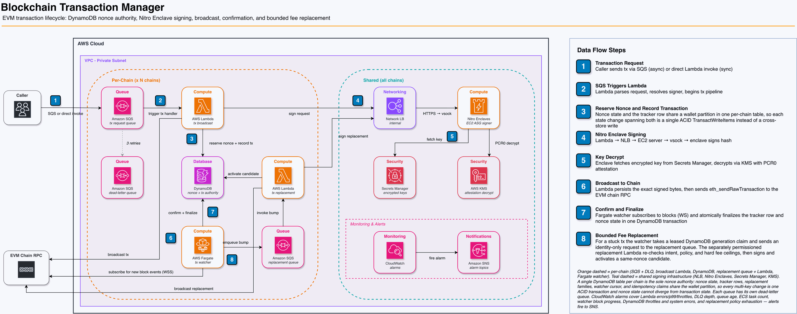

# Ethereum Transaction Manager

AWS-native sample infrastructure for reliable EVM transaction broadcasting with atomic
nonce management and secure signing via Nitro Enclaves.

> [!IMPORTANT]
> This repository is a **source-only sample/reference architecture**, not an AWS service,
> supported product, custody platform, or production-ready deployment. It distributes no
> prebuilt container image, EIF, PCR value, deployed endpoint, wallet, or credential.
> Customers must independently decide whether and how to adapt it, then review, build,
> measure, deploy, test, secure, and operate their own implementation. The primary source
> line is `main`; pin a reviewed commit rather than deploy a moving branch. Start with
> [Known Limitations and Customer Responsibilities](docs/known-limitations.md).

The tested scope is EVM-compatible chains using EIP-1559 type-2 transactions. “Multi-chain”
in this repository means multiple EVM chain deployments, not arbitrary blockchain support.

## Documentation

- **[Known Limitations](docs/known-limitations.md)** - Scope, scale boundaries, and customer responsibilities
- **[Security Model and Threat Boundaries](docs/security-model.md)** - Assets, trust boundaries, security controls, residual risks, and customer-owned controls
- **[Ingress and Multi-EVM-Chain Routing](docs/ingress-patterns.md)** - Private API Gateway and direct internal AWS ingress patterns
- **[Deployment Guide](docs/deployment-guide.md)** - Complete step-by-step deployment instructions
- **[Finch and Canary Runbook](docs/finch-and-canary-runbook.md)** - Finch build/test/run workflow and full Sepolia end-to-end canary
- **[Nitro Enclave Deployment](docs/nitro-enclave-deployment.md)** - Detailed Nitro stack setup
- **[Adding Signer Backends](docs/adding-signer-backends.md)** - How to add a new signing backend
- **[Test Suite Design](docs/test-suite-design.md)** - Test coverage and running tests

## Architecture




```
┌──────────────────────────────────────────────────────────────────────────┐
│                         Transaction Flow                                 │
├──────────────────────────────────────────────────────────────────────────┤
│                                                                          │
│   Internal Service                                                       │
│        │                                                                 │
│        ├─── lambda:InvokeFunction (sync broadcast or sign-hash)          │
│        │                    │                                            │
│        │                    ▼                                            │
│        │    ┌──────────────────┐   ┌──────────────────┐                  │
│        │    │ tx_broadcast     │──▶│ DynamoDB         │                  │
│        │    │ _lambda          │   │ (per-chain table)│                  │
│        │    │ (Lambda)         │   │                  │                  │
│        │    └────────┬─────────┘   │ • Atomic nonce   │                  │
│        │             │             │   reservation    │                  │
│        │             │             │ • TransactWrite  │                  │
│        └─── sqs:SendMessage        │ • Gap tracking   │                  │
│             (async broadcast)      └──────────────────┘                  │
│                    │                                                     │
│                    ▼                                                     │
│            ┌──────────────┐   ┌──────────────────┐                       │
│            │ SQS Queue    │──▶│ tx_broadcast     │                       │
│            │ (per-chain)  │   │ _lambda          │                       │
│            │ + DLQ        │   │ (event source)   │                       │
│            └──────────────┘   └──────────────────┘                       │
│                                                                          │
│   Lambda execution:              ┌──────────────────┐                    │
│     1. Reserve nonce (atomic)    │ Nitro Enclave    │                    │
│     2. Simulate via eth_call     │ (Signing)        │                    │
│     3. Sign via Nitro Enclave ──▶│                  │                    │
│     4. Record SIGNED bytes       └────────┬─────────┘                    │
│        before any send                    │                              │
│     5. Broadcast exact bytes     ┌────────▼─────────┐                    │
│     6. Mark PENDING (atomic)     │ Secrets Manager  │                    │
│     7. Return hash or ack SQS    │ (Encrypted Keys) │                    │
│            │                     └──────────────────┘                    │
│            ▼                                                             │
│   ┌──────────────────┐        ┌──────────────────┐                       │
│   │  DynamoDB        │◀───────│   tx_watcher     │                       │
│   │  (same table)    │        │   (ECS/Fargate)  │                       │
│   │ • Nonce+TX state │        │ • Block subs     │                       │
│   │ • Status         │        │ • Receipt check  │                       │
│   │ • Confirmations  │        │ • Status update  │                       │
│   │ • TTL (terminal) │        │ • Reorg + dropped│                       │
│   │ • Family claims  │        │ • Stuck-tx sweep │──────────┐            │
│   └────────▲─────────┘        └────────┬─────────┘          │            │
│            │                           │                    ▼            │
│            │                           ▼           ┌──────────────────┐  │
│            │                  ┌──────────────────┐ │ SQS Replacement  │  │
│            │                  │ Ethereum Node    │ │ Queue + DLQ      │  │
│            │                  │ (WebSocket)      │ │ (identity only)  │  │
│            │                  └──────────────────┘ └────────┬─────────┘  │
│            │                                                │            │
│            │                                                ▼            │
│            │                                       ┌──────────────────┐  │
│            │                                       │ tx_replacement   │  │
│            └───────────────────────────────────────│ _lambda          │  │
│              activate next candidate               │ • recheck intent,│  │
│              (same nonce, atomic)                  │   policy, caps   │  │
│                                                    │ • sign via Nitro │  │
│                                                    │ • broadcast bump │  │
│                                                    └──────────────────┘  │
│                                                                          │
└──────────────────────────────────────────────────────────────────────────┘
```

The diagram shows the direct internal AWS pattern provisioned by this repository. A
private API Gateway plus a stateless chain-router Lambda can be added as a shared ingress
front door while preserving the same per-chain queues and state isolation. See
[Ingress and Multi-EVM-Chain Routing Patterns](docs/ingress-patterns.md).

## Components

### nonce_manager

Core library for atomic nonce management with DynamoDB as the sole nonce authority.

**Features:**
- Atomic nonce reservation via conditional `TransactWriteItems` (no race conditions)
- Durable reservation before the caller returns; the reserved nonce survives a crash
- Single-store state machine: nonce state and the durable tracker row live in one
  per-chain table, so every multi-key change is one ACID transaction
- Concurrent transaction support with configurable limits
- Automatic gap detection and reuse
- Crash recovery: `RESERVED` rows are discoverable via the `status-chain-index` GSI
- Lambda-optimized executor (`LambdaExecutor`)
- Batch execution support

**Key Types:**
- `DynamoNonceManager` - Main nonce management interface
- `LambdaExecutor` - Single-shot executor for Lambda environments
- `BatchExecutor` - Parallel transaction execution

Future gap-pool performance work is intentionally measurement-gated. See
[`nonce_manager` Future Gap-Pool Optimization Roadmap](nonce_manager/README.md#future-gap-pool-optimization-roadmap)
for the priority order and safety constraints; none of those optimizations are required
for the current correctness model.

### tx_broadcast_lambda

AWS Lambda function for transaction broadcasting.

**Invocation:**
- **Sync**: `lambda:InvokeFunction` via AWS SDK (broadcast or sign-hash, routed by payload shape)
- **Async**: `sqs:SendMessage` to per-chain queue (broadcast only, fire-and-forget)

**Broadcast Flow:**
1. Receive unsigned transaction request
2. Claim the idempotency key (see below) before any nonce work; a duplicate
   short-circuits here and returns the original result
3. Resolve signer via `SignerProvider` (Nitro, Secrets Manager, or Coinbase)
4. Reserve nonce atomically in DynamoDB via conditional `TransactWriteItems`
   (durable before the handler returns; the reservation survives a crash)
5. Simulate transaction via `eth_call`
6. Build unsigned EIP-1559 tx, compute signing hash
7. Sign hash via the resolved `TransactionSigner` backend
8. Persist the exact signed bytes and tx hash to DynamoDB, then broadcast the
   encoded raw transaction to the mempool
9. Mark the transaction broadcast in DynamoDB and mark the idempotency claim completed
10. Return immediately (does NOT wait for confirmation)

All signing backends use the same unified flow: build → sign_hash → encode → send_raw_transaction.

**Idempotency / duplicate suppression:** SQS delivers at-least-once, so the same
request can arrive more than once. Before reserving a nonce, the handler writes a
claim record to the tracking table conditional on the key not already existing.
The key is taken from the request's `idempotencyKey` field, falling back to the
SQS `messageId` when absent. If the claim already exists, the duplicate returns
the original transaction's result (once the signed bytes are durably recorded or the
handler completed) or a retryable `DUPLICATE_IN_PROGRESS` error (while the original is
still reserving/signing) instead of broadcasting a second transaction. The claim is released on pre-broadcast
failures (simulation revert, nonce exhaustion, gas estimation) so a redelivery
can retry cleanly; after an ambiguous broadcast failure it is retained to fail
closed against double-broadcast.

**Sign-Hash Flow:**
1. Receive hash (raw, pre-computed EIP-712, or full EIP-712 typed data)
2. If full typed data: compute EIP-712 hash per the spec (encodeType → hashStruct → final hash)
3. Resolve signer and call `sign_hash`
4. Return signature (r, s, v); no nonce, reservation, or DynamoDB involved

**Environment Variables:**
| Variable | Description | Default |
|----------|-------------|---------|
| `RPC_SECRET_ARN` | Secrets Manager secret `{"rpcUrl": ..., "wsRpcUrl": ...}` holding the provider endpoints (and API key). Set by CDK from `rpcSecretArn`; **required in prod**. Overrides the plaintext URL variables below. | - |
| `RPC_URL` or `ETH_RPC_URL` | Ethereum HTTP RPC (`ETH_RPC_URL` takes precedence); non-prod only | `http://localhost:8545` |
| `CHAIN_ID` | Ethereum chain ID | **required** (no default; never assumes mainnet) |
| `SIGNER_BACKEND` | Default signing backend: `nitro` (alias `nitro_enclave`), `secrets_manager` (alias `secretsmanager`), or `coinbase`. Case-insensitive. The binary never fails on this variable: when it is unset or unrecognised it falls back to the compiled default, which is `nitro` for the default build (`secrets_manager` only if the `nitro` feature is compiled out). CDK always sets it explicitly and rejects unknown values at synth time | `nitro` |
| `FUNCTION_MODE` | Set to `replacement` to run the same image as the replacement worker (SQS-driven, policy-bounded same-nonce bumps). CDK sets it on the replacement Lambda only; any other value or unset selects the broadcast handler | unset |
| `NITRO_ENDPOINT` | Nitro Enclave NLB URL | - |
| `NITRO_AUTH_MODE` | How the Lambda authenticates to the signing service: `sigv4` (identity proof signed with the execution or assumed role) or `mtls` (requires `NITRO_CLIENT_IDENTITY_PATH`). Not set by CDK | `sigv4` |
| `NITRO_AUTH_ROLE_ARN` | ARN of the Nitro stack's zero-permission signing-client role that the Lambda assumes to authenticate (SigV4). Set by CDK from the `SigningClientRoleArn` output. When unset, the Lambda's own execution-role credentials are used (the Nitro stack's invoke Lambda and local tests rely on this). | - |
| `NITRO_CLIENT_IDENTITY_PATH` | Path to a PEM holding the client certificate and private key; required when `NITRO_AUTH_MODE=mtls`, ignored otherwise | - |
| `NITRO_SECRET_ID` | Secrets Manager ID for encrypted key (stored under `nitro-wallet/<name>`; the `nitro-wallet/` prefix is added automatically by deploy scripts if omitted) | - |
| `NITRO_CA_CERT_PEM` | Inline PEM of the deployment TLS CA that signed the Nitro NLB certificate. Only this CA is trusted and the NLB DNS name is checked against the certificate SAN. This is the production trust anchor; CDK sets it from `nitroCaCertPem` (or the base64 `nitroCaCertB64` context). Empty values are ignored | - |
| `NITRO_CA_CERT_PATH` | File path to a CA PEM, used when `NITRO_CA_CERT_PEM` is not set (local testing). Not set by CDK | - |
| `NITRO_SKIP_TLS_VERIFY` | Skip TLS verification for the Nitro NLB (self-signed cert in dev only) | unset |
| `SIGNER_MAPPINGS` | JSON array of `{"address": "0x…", "backend": "<backend>", "config": {}}` objects routing specific wallet addresses to a backend other than `SIGNER_BACKEND`. Here `backend` is the serde name of the enum variant: `nitro_enclave`, `secrets_manager`, or `coinbase` (the `nitro` shorthand is accepted only by `SIGNER_BACKEND`). Unparseable JSON is treated as no mappings. Not set by CDK | `[]` |
| `SECRETS_NAME` | Secrets Manager name for the `secrets_manager` backend (set by CDK) | - |
| `CDP_API_KEY_NAME` / `CDP_API_KEY_SECRET_ARN` / `CDP_WALLET_SECRET_NAME` / `CDP_WALLET_SECRET_ARN` | Coinbase Developer Platform backend (`coinbase` feature only). The `_ARN` variables carry Secrets Manager ARNs rather than PEM material; all four must be set or the backend is not initialised. Raw-PEM `CDP_API_KEY_SECRET` / `CDP_WALLET_SECRET` are accepted only in debug builds and are compiled out of release builds | - |
| `DYNAMODB_TABLE` | Transaction tracking table (CDK sets this to `{resourcePrefix}-tracker`) | **required** |
| `TTL_DAYS` | DynamoDB record TTL | `7` |
| `DEFAULT_GAS_LIMIT` | Gas limit used for a simple transfer (empty `data`) when the caller supplied none and estimation fails; contract calls fail closed with `GAS_ESTIMATION_FAILED` instead | `21000` |
| `GAS_BUFFER_PERCENTAGE` | Percentage added to the estimated gas limit | `20` |
| `REPLACEMENT_ENABLED` | Enable family-backed dynamic same-nonce replacement for live fee-tier requests | `true` |
| `SIGN_HASH_ENABLED` | Allow direct invocations to use the sign-hash path. While on, every principal that can invoke the Lambda can obtain a signature over any digest (see [Security Model](docs/security-model.md#ingress-and-signing-authority)); set `false` for broadcast-only deployments | `true` |
| `DEFAULT_MAX_FEE_PER_GAS_WEI` / `HARD_MAX_FEE_PER_GAS_WEI` | Default and non-bypassable deployment cap per gas. Startup fails if the default exceeds the hard cap. CDK passes the same values from the `defaultMaxFeePerGasWei` / `hardMaxFeePerGasWei` context | `150000000000` / `500000000000` |
| `DEFAULT_MAX_TOTAL_FEE_WEI` / `HARD_MAX_TOTAL_FEE_WEI` | Default and non-bypassable `gasLimit × maxFee` budget. Startup fails if the default exceeds the hard cap. CDK passes the same values from the `defaultMaxTotalFeeWei` / `hardMaxTotalFeeWei` context | `20000000000000000` / `100000000000000000` |
| `MAX_REPLACEMENT_ATTEMPTS` | Deployment maximum replacement generations | `3` |
| `FEE_TIP_FLOOR_WEI` | Minimum live percentile tip | `100000000` |

### tx_watcher

Long-running service (ECS/Fargate) for transaction finality tracking with chain reorganization detection.

**Flow:**
1. Subscribe to new blocks via WebSocket
2. Track block hashes to detect chain reorganizations
3. Query DynamoDB for pending/mined transactions
4. Fetch receipts for pending transactions
5. Update status: MINED → CONFIRMED or FAILED
6. Handle reorgs: atomically reset affected transactions back to SIGNED (when the row
   carries its exact signed bytes, so they are rebroadcast verbatim) or PENDING
7. Detect dropped transactions: a PENDING (or never-acked SIGNED) tx older than
   `STUCK_THRESHOLD_SECS` with no receipt whose nonce the chain has already passed
   is marked DROPPED, and its nonce is finalized in DynamoDB (consumed, not reused,
   because a different tx spent it)
8. Re-inject stale transactions: a PENDING tx older than `STUCK_THRESHOLD_SECS`
   whose nonce is still unconsumed is re-sent with its exact stored bytes (same
   hash) once per threshold interval, so a mempool eviction cannot strand the wallet.
   Only a family's active candidate is re-injected; superseded candidates are
   receipt-tracked only
9. Rebroadcast SIGNED rows whose first send was never acknowledged, with identical
   bytes, until the node acks or the nonce resolves
10. For a due active replacement family, acquire a leased DynamoDB generation claim and
    send an identity-only request to the internal replacement queue. The separately
    permissioned replacement Lambda reloads immutable intent/policy, rechecks receipt,
    nonce, cadence, and hard budgets, then signs and atomically activates the next candidate.

**Reorg Detection:**
- Tracks recent block hashes (up to 256 blocks)
- Detects forks via O(1) `hash_to_number` lookup on new block's parent hash
- Identifies all orphaned blocks between fork point and new block height
- Atomically resets affected transactions from MINED/CONFIRMED to SIGNED (rows with stored bytes) or PENDING (single DynamoDB write per tx, no intermediate REORGED state)
- Falls back to orphaning all tracked blocks if parent hash is unknown
- Configurable finality threshold (default: required_confirmations + 20 blocks)

**Environment Variables:**
| Variable | Description | Default |
|----------|-------------|---------|
| `RPC_SECRET_ARN` | Secrets Manager secret with `rpcUrl` and `wsRpcUrl`; **required in prod**, overrides the URL variables below | - |
| `WS_RPC_URL` | Ethereum WebSocket RPC (non-prod only) | `ws://localhost:8546` |
| `HTTP_RPC_URL` | Ethereum HTTP RPC for receipt/nonce queries (non-prod only; CDK sets it from `rpcUrl`) | `http://localhost:8545` |
| `DYNAMODB_TABLE` | Transaction tracking table (CDK sets this to `{resourcePrefix}-tracker`) | **required** |
| `CHAIN_ID` | Ethereum chain ID | **required** |
| `REQUIRED_CONFIRMATIONS` | Blocks for finality | `12` |
| `STUCK_THRESHOLD_SECS` | Pending TX timeout | `300` |
| `TTL_DAYS` | TTL stamped on terminal tracker rows (CDK passes it from `ttlDays`) | `7` |
| `RECONNECT_DELAY_SECS` | Delay before reconnecting after a WebSocket disconnect | `5` |
| `BLOCK_STALL_TIMEOUT_SECS` | Reconnect if no block header arrives within this window (silent WebSocket stall) | `120` |
| `HEARTBEAT_PATH` | File rewritten after every processed block; read by the ECS health check | `/tmp/tx_watcher_heartbeat` |
| `REPLACEMENT_QUEUE_URL` | Internal send-only queue for policy-authorized replacement requests (set by CDK) | - |

The watcher emits one CloudWatch Embedded Metric Format document per processed block to
stdout (namespace `TxManager/Watcher`, dimension `ChainId`): `BlocksProcessed`,
`BlockLagSeconds` (now minus block timestamp), and `ActiveTransactions`. No CloudWatch
SDK or IAM permission is needed; the `awslogs` driver delivers them.

## DynamoDB Schema

The CDK creates the table as `{resourcePrefix}-tracker` (e.g., `eth-tx-tracker`, or
`sepolia-dev-tracker` when deployed via `deploy-chain.sh`). The actual name is
exported as the `TxTrackerTableName` stack output. Both the Lambda and the watcher
require `DYNAMODB_TABLE` and `CHAIN_ID` explicitly; there are no defaults.

| Attribute | Type | Description |
|-----------|------|-------------|
| `wallet` (PK) | String | Wallet address (lowercase) |
| `tx_hash` (SK) | String | Transaction hash (lowercase) |
| `nonce` | Number | Nonce used |
| `status` | String | SIGNED, PENDING, MINED, CONFIRMED, FAILED, DROPPED, REJECTED, REPLACED |
| `chain_id` | Number | Ethereum chain ID |
| `block_number` | Number | Block when mined (optional) |
| `block_hash` | String | Block hash when mined (for reorg detection) |
| `confirmations` | Number | Current confirmation count |
| `success` | Boolean | On-chain success status |
| `gas_price` | Number | Legacy gas price in wei (optional; EIP-1559 rows carry the two fee fields below instead) |
| `max_fee_per_gas` | Number | EIP-1559 max fee per gas in wei the stored bytes were signed with (optional) |
| `max_priority_fee_per_gas` | Number | EIP-1559 priority fee in wei the stored bytes were signed with (optional) |
| `signed_raw_tx` | String | The exact signed EIP-2718 transaction bytes as `0x`-hex. The watcher's re-injection and SIGNED-row rebroadcast resend these bytes verbatim (same hash), so exact-byte recovery depends on this attribute |
| `submitted_at` | String | ISO 8601 timestamp |
| `updated_at` | String | ISO 8601 timestamp |
| `ttl` | Number | TTL epoch seconds |
| `family_nonce` | Number | Same-nonce replacement family identifier (candidate rows only) |
| `replacement_generation` | Number | Candidate generation, original = 0 |
| `replacement_active` | Boolean | Whether this is the family's current candidate |

**Nonce reservation row (same table):** `reservation#<20-digit nonce>` is written when a
nonce is reserved and updated in the same transaction that writes the tracker row. It
carries `state` (`RESERVED` then `SIGNED`), `reserved_at`, and, once signed, `real_tx_hash`
(the broadcast hash), `signed_at`, `retry_count`, and the same `gas_price` /
`max_fee_per_gas` / `max_priority_fee_per_gas` fee fields as the tracker row. Its
`status` and `chain_id` are removed on signing so it leaves the GSI.

**Replacement family row (same table):** `family#<20-digit nonce>` stores immutable
transaction intent and replacement policy, active generation/hash/fees, block cadence,
claim lease, and terminal winner. It deliberately omits `status`, so it never enters the
GSI. One nonce family owns one reservation and one `pending_count` slot regardless of the
number of candidate hashes. Its payload attributes are: `row_type` (`REPLACEMENT_FAMILY`),
`nonce`, `chain_id`, the immutable intent `to`, `value`, `data`, `gas_limit`, the policy
`fee_speed`, `bump_every_blocks`, `max_bumps`, `on_exhaust`, `max_fee_per_gas_ceiling`,
`max_total_fee_ceiling`, the live candidate `active_hash`, `active_generation`,
`active_max_fee_per_gas`, `active_max_priority_fee_per_gas`, `next_eligible_block`,
`family_state` (`ACTIVE` until a terminal outcome), the lease `claim_generation` /
`claim_until_block` (present only while a replacement is claimed), `created_at`,
`updated_at`, and on termination `winner_hash` or `exhaustion_reason` plus `ttl`.

**GSI: `status-chain-index`**
- Partition key: `status`
- Sort key: `chain_id`
- Enables efficient queries for pending transactions by chain

**Watcher cursor (same table):** one row per chain keyed `watcher#<chain_id>` /
`cursor` holding `last_block`, rewritten after every processed block. On restart the
watcher backfills reorg tracking from there (bounded to the most recent 256 blocks). It
carries no `status`/`chain_id` attributes and never appears in the GSI.

**Idempotency records (same table):** Duplicate suppression reuses this table.
A claim is stored under the same `wallet` partition key with a sort key of
`idem#<key>` (vs. a `0x…` tx hash for real transactions). These records carry
`idem_status` (`IN_PROGRESS` → `HANDED_OFF` once the signed bytes are durable →
`COMPLETED`) plus the original `result_tx_hash` and `result_nonce`, and deliberately omit the `status` and `chain_id`
attributes so they stay out of the sparse `status-chain-index` GSI and are never
seen by the watcher. They share the same `ttl` cleanup.

## Signing Backends

All backends use a unified raw transaction flow via the `TransactionSigner` trait: build unsigned tx → compute signing hash → `sign_hash()` → encode signed tx → `send_raw_transaction()`. The `SignerProvider` routes to the correct backend based on `SIGNER_BACKEND` env var or per-request `signerCredentials`.

Nitro Enclaves is the sample's default custody pattern. Alternative backends are included
for development or customer-specific evaluation; customers must select and review their own
signing architecture.

### Nitro Enclave (Sample Default)

Private keys are generated and stored securely:
- Keys generated inside the enclave using KMS `GenerateDataKey`
- Plaintext never exists outside the attested enclave
- Encrypted keys stored in Secrets Manager
- Signing happens inside the enclave via HTTP API

```
Lambda ──HTTPS──▶ Nitro NLB ──▶ EC2 ──vsock──▶ Enclave
                                                  │
                                          KMS Decrypt
                                          Sign Hash
                                          Return Signature
```

### Alternative Backends

For development or customer-specific evaluation, other backends are available:

**Secrets Manager (plaintext keys):** selected per deployment with
`SIGNER_BACKEND=secrets_manager` and `SECRETS_NAME` (CDK context `signerBackend`). It has
no per-request `signerCredentials` form; a request that supplies one is rejected.

**Coinbase Developer Platform:**
```json
{
  "signerCredentials": {
    "backend": "coinbase",
    "walletSecretArn": "arn:aws:secretsmanager:..."
  }
}
```

## Design Decisions

### Why DynamoDB as the Sole Nonce Authority?

1. **One ACID store** - Nonce state and the durable tracker row live in a single
   per-chain table, so every multi-key change is one `TransactWriteItems`. There is
   no second store and no window between two unsynchronized writes.
2. **Atomic reservation** - Conditional `TransactWriteItems` hands out each nonce
   exactly once, preventing race conditions across concurrent invocations.
3. **Durable before return** - The reservation is committed before the handler
   returns, so a reserved nonce survives a crash and is recoverable via the
   `status-chain-index` GSI.
4. **Gap tracking** - Gap-pool rows track and reuse nonces from failed transactions.
5. **Serverless** - No capacity planning, pay-per-request, no cluster to operate.

### Why DynamoDB for Transaction State?

1. **Durability** - Transactions must survive Lambda/watcher restarts
2. **TTL** - Automatic cleanup of old records
3. **GSI** - Efficient queries by status across all wallets
4. **Serverless** - No capacity management, pay-per-request

### Why Separate Lambda and Watcher?

1. **Lambda limitations** - 15-minute max execution, not suitable for waiting on confirmations
2. **Cost optimization** - Lambda exits immediately after broadcast
3. **Reliability** - Watcher can restart without losing transaction state
4. **Scalability** - Lambda scales horizontally for burst traffic

### Why WebSocket Block Subscriptions?

1. **Efficiency** - Push-based, no polling overhead
2. **Latency** - Immediate notification of new blocks
3. **Reliability** - Automatic reconnection on disconnect
4. **Resource usage** - Single connection vs repeated HTTP requests

### Nonce Management Strategy

The strategy follows the pattern common to production EVM relayers (a single durable nonce authority that reserves optimistically, tracks gaps, and reconciles against the chain):

1. **Optimistic reservation** - Reserve nonce before simulation
2. **Atomic reservation** - Conditional `TransactWriteItems` hands out each nonce exactly once
3. **Gap recovery** - Track and reuse gaps from failed transactions
4. **Concurrent limit** - Prevent runaway nonce reservation
5. **Blockchain sync** - Periodic reconciliation with on-chain state

## Deployment

**📖 For the sample deployment procedure, see [docs/deployment-guide.md](docs/deployment-guide.md).**
A successful deployment demonstrates only the sample path in that environment; it is not a
production approval or recommendation.

The system uses AWS Nitro Enclaves for secure transaction signing by default. Deployment is a two-layer process:

1. **Deploy Nitro Enclave stack** (shared, chain-agnostic signing infrastructure)
2. **Deploy TX Manager stack(s)** (one per chain, sharing the Nitro signer; each chain
   owns its DynamoDB nonce/lifecycle authority)

### Security Model

Private keys are generated inside the Nitro Enclave using KMS `GenerateDataKey`:
- Randomness comes from KMS's FIPS 140-3 Security Level 3 validated HSMs
- Plaintext key exists only inside the attested enclave
- Ciphertext is stored in Secrets Manager for later decryption

This ensures the plaintext private key never exists outside the enclave - not during generation, not during signing.

### Multi-EVM-Chain Architecture

```
┌─────────────────────────────────────────────────────────────────────────────┐
│                    Shared Infrastructure (deployed once)                      │
│                                                                              │
│   ┌─────────────────────────────────┐                                       │
│   │  Nitro Enclave Stack            │                                       │
│   │  NLB ──▶ EC2 ──▶ Enclave       │                                       │
│   │  (chain-agnostic signing)       │                                       │
│   └─────────────────────────────────┘                                       │
└─────────────────────────────────────────────────────────────────────────────┘
                    ▲               ▲               ▲
                    │               │               │
         ┌──────────┴───┐  ┌───────┴───────┐  ┌───┴──────────┐
         │ TX Manager   │  │ TX Manager    │  │ TX Manager   │
         │ Ethereum     │  │ Arbitrum      │  │ Base         │
         │ chainId=1    │  │ chainId=42161 │  │ chainId=8453 │
         └──────────────┘  └───────────────┘  └──────────────┘
         (DynamoDB, Lambda, ECS, SQS per chain)
```

The Nitro signer is chain-agnostic: it signs 32-byte hashes. The chain ID is embedded in the transaction hash computed by each TX Manager. Nonce state is isolated per chain because each chain owns its own DynamoDB tracker table. This means:
- **1 Nitro stack** serves all chains (signing)
- **N TX Manager stacks** (one per chain), each with its own DynamoDB nonce/lifecycle authority plus isolated Lambda/ECS/SQS
- Same Ethereum address/key works across all EVM chains

### Step 1: Deploy Nitro Enclave Stack

See [docs/nitro-enclave-deployment.md](docs/nitro-enclave-deployment.md) for detailed instructions.

```bash
# Quick start (NITRO_SECRET_ID = the one wallet the signer uses; default nitro-wallet/<env>)
NITRO_SECRET_ID=nitro-wallet/treasury-key ./scripts/deploy-nitro-stack.sh dev us-east-1

# Or manually:
cd nitro_enclave_signer
python3 -m venv .venv && source .venv/bin/activate
pip install -r requirements.txt
./scripts/build_kmstool_enclave_cli.sh
export CDK_DEPLOY_REGION=us-east-1
export CDK_DEPLOY_ACCOUNT=$(aws sts get-caller-identity --query Account --output text)
cdk deploy devNitroWalletEth --context deployment=dev \
  --context secretId=nitro-wallet/treasury-key
```

The `deployment` context is **required** (`dev`, `staging`, or `prod`). Dev enables `--debug-mode` on the enclave for console access. A debug-mode enclave attests PCR0 as 96 zeros whatever image it runs, so dev cannot enforce the measured EIF value and provides no enclave-boundary guarantee. Staging and prod disable debug mode and enforce the real measurement.

After deployment:
1. Redeploy with the enclave measurement. This is **required before key generation**. Until you do,
   the key policy denies `kms:Decrypt` to every principal and signing fails closed:
   ```bash
   # staging/prod: read PCR0 from the EIF you built, then pass it as a deploy-time input:
   cdk deploy prodNitroWalletEth --context deployment=prod --context pcr0=<PCR0_FROM_DESCRIBE_EIF>

   # dev: the debug-mode enclave can only attest the all-zero value. CDK accepts it for dev
   # only and warns that any debug enclave on the parent can then decrypt.
   cdk deploy devNitroWalletEth --context deployment=dev --context pcr0=$(printf '0%.0s' $(seq 96))

   # Confirm what the deployed policy actually enforces:
   ./scripts/verify-kms-attestation.sh
   ```
   CDK owns the key policy, writing an explicit `Deny` for unattested decrypt alongside the
   attested `Allow`. An `Allow` alone cannot subtract the account-root delegation, so the
   `Deny` is what enforces the enclave boundary. Applying the statement by hand does not
   persist: the next `cdk deploy` overwrites it. See [deployment guide §2.4](docs/deployment-guide.md#24-enforce-enclave-attestation-on-the-kms-key).
2. Generate keys: `./scripts/generate-nitro-key.sh <secret-name>` (e.g., `treasury-key`)
   - This creates a key inside the enclave and stores the encrypted result in Secrets Manager. The script automatically prepends the `nitro-wallet/` prefix required by the Nitro IAM policy, so the secret lands at `nitro-wallet/<secret-name>`.
   - The name must match the Nitro stack's `secretId`/`NITRO_SECRET_ID`; the signer never uses a key stored under any other name.
3. Note the `NITRO_ENDPOINT` from `.nitro-config` or script output

### Step 2: Deploy TX Manager Stack(s)

The TX Manager **must be deployed in the same VPC as the Nitro stack** because the Nitro NLB is internal and only reachable from within that VPC. The `deploy-chain.sh` script auto-sources `.nitro-config` (VPC ID, Nitro endpoint, security group) and looks up that VPC directly; it deploys only the per-chain stack.

```bash
cd infra && npm install && cd ..

# Deploy for Sepolia testnet (dev)
export SEPOLIA_RPC_URL="https://eth-sepolia.g.alchemy.com/v2/KEY"
export SEPOLIA_WS_URL="wss://eth-sepolia.g.alchemy.com/v2/KEY"
export NITRO_SECRET_ID="sepolia-treasury"
./scripts/deploy-chain.sh sepolia dev

# Strict configuration profile (environment=prod), shown here on a testnet. It refuses
# plaintext RPC URLs (the endpoints, which embed the provider API key, must come from
# Secrets Manager), requires an alarm subscriber, and rejects TLS verification bypass.
# It is the strictest profile the sample offers, not an endorsement for mainnet use as-is.
aws secretsmanager create-secret --name tx-manager/sepolia/rpc \
  --secret-string '{"rpcUrl":"https://eth-sepolia.g.alchemy.com/v2/KEY","wsRpcUrl":"wss://eth-sepolia.g.alchemy.com/v2/KEY"}'
export RPC_SECRET_ARN="arn:aws:secretsmanager:us-east-1:123456789012:secret:tx-manager/sepolia/rpc-AbCdEf"
export ALARM_EMAIL="alerts@example.com"
./scripts/deploy-chain.sh sepolia prod

# Other chains: one RPC secret per chain, same Nitro endpoint
export RPC_SECRET_ARN="arn:aws:secretsmanager:...:secret:tx-manager/base-sepolia/rpc-..."
./scripts/deploy-chain.sh base-sepolia prod
```

### Prerequisites

- AWS account with appropriate permissions
- Node.js 22 LTS and npm
- Python 3.11 (for Nitro CDK and local tests; the enclave image carries its pinned runtime)
- Rust 1.94.1 via `rust-toolchain.toml` (local development/tests; images build Rust inside the container)
- AWS CDK CLI (`npm install -g aws-cdk`)
- Docker (for building container images)
- Ethereum node with HTTP and WebSocket endpoints

### Deploy Without Nitro (Dev Only)

For development without Nitro (uses Secrets Manager with plaintext keys; **NOT recommended for production**):

```bash
cd infra && npm install
npx cdk bootstrap
npx cdk deploy TxManagerChain \
  --context rpcUrl=https://your-eth-node \
  --context wsRpcUrl=wss://your-eth-node/ws \
  --context vpcId=vpc-xxx \
  --context chainId=1 \
  --context signerBackend=secrets_manager
```

Callers must provide the key's Secrets Manager ARN per request via [`signerCredentials`](#alternative-backends).

Nitro is the sample's default custody pattern. Anyone independently adapting this source must
review its trust model, reproduce the EIF/PCR evidence, and configure and validate controls
appropriate to its own use case.

### Configuration Options

**Per-chain stack** (passed via `deploy-chain.sh` or `--context`):

| Parameter | Description | Default |
|-----------|-------------|---------|
| `rpcSecretArn` | Secrets Manager secret `{"rpcUrl": "https://…", "wsRpcUrl": "wss://…"}`. **Required for `environment=prod`** (`RPC_SECRET_ARN` in `deploy-chain.sh`); the URLs never enter the template or task/function environment | - |
| `rpcUrl` | Ethereum HTTP RPC URL (plaintext env var; non-prod only) | - |
| `wsRpcUrl` | Ethereum WebSocket RPC URL (plaintext env var; non-prod only) | - |
| `chainId` | Ethereum chain ID | `1` |
| `vpcId` | VPC ID (auto-sourced from `.nitro-config`) | - |
| `synthMode` | `true` makes `cdk synth` import a deterministic placeholder VPC and signing-client role so it runs with no credentials or account (CI and the `infra/test` checks). Never deploy a synthMode stack | `false` |
| `signerBackend` | Signer backend for the broadcast Lambda: `nitro`, `secrets_manager`, or `coinbase` (`SIGNER_BACKEND`). Defaults to `nitro` when `nitroEndpoint` is set; otherwise it must be given explicitly and the deploy fails without it | `nitro` if `nitroEndpoint` is set |
| `nitroEndpoint` | Nitro Enclave NLB URL (auto-sourced from `.nitro-config`) | - |
| `nitroAuthRoleArn` | ARN of the Nitro stack's `SigningClientRoleArn` output, passed to the Lambda as `NITRO_AUTH_ROLE_ARN` with an `sts:AssumeRole` grant on exactly that role (`deploy-chain.sh` reads it from `.nitro-config`). **Required whenever `signerBackend=nitro`**, including a prod Nitro deployment | - |
| `nitroCaCertPem` / `nitroCaCertB64` | The deployment TLS CA that signed the Nitro NLB certificate, passed to the Lambda as `NITRO_CA_CERT_PEM`. `deploy-chain.sh` passes the base64 form (`NITRO_CA_CERT_B64` from `.nitro-config`) because `--context` drops multi-line values; the stack decodes it. **Required for `environment=prod` with a Nitro endpoint** (the only alternative, `nitroSkipTlsVerify`, is rejected for prod) | - |
| `nitroSkipTlsVerify` | Skip TLS verification against the Nitro NLB (`NITRO_SKIP_TLS_VERIFY=true`); self-signed dev/test certs only. Rejected when `environment=prod` | `false` |
| `nitroSecretId` | Secret ID the signing service was deployed with. Log label only; the service picks the wallet, not the caller. | - |
| `nitroSecurityGroupId` | Nitro instance SG (auto-sourced from `.nitro-config`) | - |
| `environment` | Configuration profile (`dev`, `staging`, `prod`). `prod` is the strictest profile and the fail-closed default; it is not a production-readiness claim | `prod` |
| `destroyOnRemoval` | Delete all resources on stack removal (dev/test only) | `false` |
| `dynamoDbKmsKeyArn` | Existing customer CMK ARN for tracker-table encryption (`DYNAMODB_KMS_KEY_ARN`); mutually exclusive with create mode | - (AWS-owned encryption) |
| `createDynamoDbKmsKey` | Create a rotating stack-owned CMK (`CREATE_DYNAMODB_KMS_KEY=true`) | `false` |
| `stackName` | CloudFormation stack name | `TxManagerChain` |
| `ttlDays` | DynamoDB record TTL | `7` |
| `requiredConfirmations` | Blocks for finality | `12` |
| `watcherCpu` | ECS task CPU units | `256` |
| `watcherMemory` | ECS task memory (MB) | `512` |
| `stuckThresholdSecs` | Pending TX timeout | `300` |
| `lambdaReservedConcurrency` | Reserved concurrency for the broadcast Lambda (bounds RPC pressure and account-pool use) | `50` |
| `sqsMaxConcurrency` | Max concurrent invocations the SQS event source drives (≤ reserved concurrency) | `10` |
| `replacementEnabled` | Enable live-tier same-nonce replacement families | `true` |
| `signHashEnabled` | Allow the sign-hash path on the broadcast Lambda (`SIGN_HASH_ENABLED`); `false` for broadcast-only deployments | `true` |
| `defaultMaxFeePerGasWei` / `hardMaxFeePerGasWei` | Default and non-bypassable per-gas policy ceilings (wei); passed to both Lambdas unchanged | `150000000000` / `500000000000` |
| `defaultMaxTotalFeeWei` / `hardMaxTotalFeeWei` | Default and non-bypassable total-fee policy ceilings (wei); passed to both Lambdas unchanged | `20000000000000000` / `100000000000000000` |
| `maxReplacementAttempts` | Deployment maximum replacement generations | `3` |
| `feeTipFloorWei` | Minimum live percentile tip | `100000000` |
| `replacementReservedConcurrency` | Reserved concurrency for the replacement Lambda (minimum 2) | `2` |
| `watcherStallSecs` | Seconds without a processed block before the watcher task is replaced and the progress alarm fires (min 60) | `300` |
| `alarmEmail` | Email subscribed to the alarm topic. **Required for `environment=prod`** unless `alarmTopicArn` is set (`ALARM_EMAIL` in `deploy-chain.sh`) | - |
| `alarmTopicArn` | Existing SNS topic to notify instead of the per-stack topic (`ALARM_TOPIC_ARN` in `deploy-chain.sh`) | - |
| `resourcePrefix` | Unique prefix for per-chain resources | `eth-tx` |

### Multi-EVM-Chain Deployment

Each chain deploys its own fully isolated stack (DynamoDB, Lambda, ECS, SQS) into the
existing Nitro Enclave signer VPC and shares only the chain-agnostic Nitro signer. Nonce
state is isolated per chain because each chain owns its own DynamoDB tracker table.

```bash
# Deploy chains: each is a self-contained per-chain stack
# dev/staging may pass plaintext URLs; the strict prod profile requires RPC_SECRET_ARN + ALARM_EMAIL
export SEPOLIA_RPC_URL=https://eth-sepolia.g.alchemy.com/v2/YOUR_KEY
export SEPOLIA_WS_URL=wss://eth-sepolia.g.alchemy.com/v2/YOUR_KEY
./scripts/deploy-chain.sh sepolia dev

export ARBITRUM_SEPOLIA_RPC_URL=https://arb-sepolia.g.alchemy.com/v2/YOUR_KEY
export ARBITRUM_SEPOLIA_WS_URL=wss://arb-sepolia.g.alchemy.com/v2/YOUR_KEY
./scripts/deploy-chain.sh arbitrum-sepolia dev

export ALARM_EMAIL=alerts@example.com
export RPC_SECRET_ARN=arn:aws:secretsmanager:...:secret:tx-manager/base-sepolia/rpc-...
./scripts/deploy-chain.sh base-sepolia prod
```

**Chain-specific settings** (hardcoded in `deploy-chain.sh`):

| Chain | Chain ID | Confirmations | Notes |
|-------|----------|---------------|-------|
| Ethereum | 1 | 12 | Highest security, slowest finality |
| Sepolia | 11155111 | 3 | Ethereum testnet |
| Polygon | 137 | 128 | Frequent reorgs, needs more confirmations |
| Amoy | 80002 | 5 | Polygon testnet |
| Arbitrum | 42161 | 1 | L2, inherits Ethereum security |
| Arbitrum-Sepolia | 421614 | 1 | Arbitrum testnet |
| Optimism | 10 | 1 | L2, inherits Ethereum security |
| Optimism-Sepolia | 11155420 | 1 | Optimism testnet |
| Base | 8453 | 1 | L2, inherits Ethereum security |
| Base-Sepolia | 84532 | 1 | Base testnet |

### Post-Deployment

1. Generate signing keys via Nitro Enclave:
   ```bash
   ./scripts/generate-nitro-key.sh my-wallet-key
   # Returns: address and stores encrypted key in Secrets Manager
   ```

2. Verify stack outputs:
   ```bash
   aws cloudformation describe-stacks \
     --stack-name TxManager-Sepolia-Dev \
     --query 'Stacks[0].Outputs'
   ```
   (Replace with your chain/env; stacks are named `TxManager-<Chain>-<Env>`.)

3. Fund the generated address with ETH for gas fees.

### Stack Resources

**Per-chain TxManagerStack** (one per chain):
- DynamoDB table with GSI (nonce authority + transaction tracking)
- Lambda function (transaction broadcast + sign-hash)
- ECS Fargate service (transaction watcher)
- SQS queues with DLQ (async submission)
- Secrets Manager plaintext-key secret (only when `signerBackend=secrets_manager`)
- Security groups with least-privilege access
- CloudWatch alarms (Lambda errors, ECS task count, DLQ, DynamoDB errors)

**Nitro Enclave stack** (deployed separately via `nitro_enclave_signer/`):
- EC2 instances with Nitro Enclave support
- Network Load Balancer (internal)
- KMS key for key encryption
- Auto Scaling Group

## API

Callers can use either of the documented [ingress patterns](docs/ingress-patterns.md):
a private API Gateway front door with stateless chain routing, or direct internal AWS
access. This repository provisions the direct resources, where callers use
`lambda:InvokeFunction` (sync) or `sqs:SendMessage` (async broadcast). The payload format
determines the operation.

### Broadcast

Submit a transaction for broadcasting. Invoke directly for a synchronous response, or send to SQS for fire-and-forget.

**Request:**
```json
{
  "from": "0x...",
  "to": "0x...",
  "value": "1000000000000000000",
  "data": "0x...",
  "chainId": 1,
  "gasLimit": 21000,
  "maxFeePerGas": "50000000000",
  "maxPriorityFeePerGas": "2000000000",
  "idempotencyKey": "client-supplied-unique-id"
}
```

For direct invocation, `idempotencyKey` is required and must be a stable, request-unique
value; a duplicate returns the first result. SQS delivery falls back to the queue
`messageId` when the body omits it.

The explicit fee pair above preserves caller-selected fees and is not automatically
replacement-managed unless `replacementPolicy` is supplied. Alternatively, choose live
fee estimation and bounded replacement:

```json
{
  "from": "0x...",
  "to": "0x...",
  "value": "0",
  "chainId": 1,
  "gasLimit": 21000,
  "feeSpeed": "standard",
  "replacementPolicy": {
    "bumpEveryBlocks": 5,
    "maxBumps": 3,
    "onExhaust": "hold",
    "maxFeePerGasWei": "150000000000",
    "maxTotalFeeWei": "15000000000000000"
  },
  "idempotencyKey": "client-supplied-unique-id"
}
```

`slow`, `standard`, and `fast` select live fee-history percentiles and base-fee headroom;
customers must tune policy and deployment hard maxima for their chain/workload. See
[Dynamic Fee Replacement Design](docs/fee-bump-replacement-design.md).

**Response (Success):**
```json
{
  "success": true,
  "txHash": "0x...",
  "nonce": 42
}
```

**Response (Error):**
```json
{
  "success": false,
  "error": "Simulation reverted: insufficient balance",
  "errorCode": "SIMULATION_FAILED",
  "retryable": false
}
```

### Sign Hash

Sign a hash without broadcasting a transaction. Supports three modes. Invoked via direct Lambda invocation (`lambda:InvokeFunction`). SQS events always route to broadcast.

**Mode 1 (raw hash):**
```json
{
  "from": "0x...",
  "hash": "0xabcdef1234567890abcdef1234567890abcdef1234567890abcdef1234567890"
}
```

**Mode 2 (pre-computed EIP-712 hashes):**
```json
{
  "from": "0x...",
  "domainSeparator": "0x...",
  "structHash": "0x..."
}
```

**Mode 3 (full EIP-712 typed data)** (standard format per [EIP-712](https://eips.ethereum.org/EIPS/eip-712)):
```json
{
  "from": "0x...",
  "typedData": {
    "types": {
      "EIP712Domain": [
        { "name": "name", "type": "string" },
        { "name": "version", "type": "string" },
        { "name": "chainId", "type": "uint256" },
        { "name": "verifyingContract", "type": "address" }
      ],
      "Permit": [
        { "name": "owner", "type": "address" },
        { "name": "spender", "type": "address" },
        { "name": "value", "type": "uint256" },
        { "name": "nonce", "type": "uint256" },
        { "name": "deadline", "type": "uint256" }
      ]
    },
    "primaryType": "Permit",
    "domain": {
      "name": "MyToken",
      "version": "1",
      "chainId": 11155111,
      "verifyingContract": "0xCcCCccccCCCCcCCCCCCcCcCccCcCCCcCcccccccC"
    },
    "message": {
      "owner": "0x...",
      "spender": "0x...",
      "value": "1000000000000000000",
      "nonce": 0,
      "deadline": 1893456000
    }
  }
}
```

All three modes also accept optional `signerCredentials` for per-request backend override.

**EIP-191 `personal_sign`** has no dedicated mode. Compute the digest yourself and submit
it as a raw hash: `keccak256("\x19Ethereum Signed Message:\n" + len(message) + message)`,
where `len` is the message's byte length in decimal ASCII (for example
`eth_account.messages.encode_defunct` + `_hash_eip191_message`, or viem's `hashMessage`).

Raw-hash mode signs any 32-byte digest, including transaction hashes for any chain, so a
caller allowed to invoke it effectively holds signing authority for the wallet and can
bypass nonce management and fee caps. Grant `lambda:InvokeFunction` accordingly; see
[Security Model](docs/security-model.md).

**Response (Success):**
```json
{
  "success": true,
  "r": "0x...",
  "s": "0x...",
  "v": 27,
  "signature": "0x...65-byte-compact-hex..."
}
```

**Response (Error):**
```json
{
  "success": false,
  "error": "EIP-712 encoding error: missing field 'owner' in type 'Permit'",
  "errorCode": "SIGNER_ERROR"
}
```

No nonce management or DynamoDB involved; this is a stateless signing operation.

### SQS Async Submission

Transactions can also be submitted via the SQS queue (URL in stack output `QueueUrl`) for fire-and-forget async processing. The message body is the same JSON format as the direct invocation request:

```bash
aws sqs send-message \
  --queue-url $QUEUE_URL \
  --message-body '{
    "from": "0x...",
    "to": "0x...",
    "value": "1000000000000000000",
    "chainId": 1
  }'
```

The Lambda processes one message at a time (batch size 1). Failed messages retry up to 3 times before moving to the dead letter queue. Since the response is not returned to the caller, check DynamoDB or Lambda logs for the transaction result.

Internal AWS services can send directly to SQS or invoke the Lambda directly via the AWS SDK.

## Integration Guide

### Choosing an ingress pattern

- **Private multi-EVM-chain front door:** private API Gateway → stateless router Lambda →
  per-chain SQS. Use this for centralized IAM policy, validation, throttling, and one
  endpoint across chains.
- **Direct internal AWS access:** trusted services call each chain's SQS queue or Lambda
  ARN with the AWS SDK. Use this for the smallest infrastructure and direct sync/signing
  responses.

The sections below show direct internal integration, which is provisioned by the current
CDK stack. See [Ingress and Multi-Chain Routing Patterns](docs/ingress-patterns.md) for the
private API design and the controls common to both patterns.

### Architecture Overview

A multi-EVM-chain deployment has two layers of infrastructure:

```
┌─────────────────────────────────────────────────────────────────────────┐
│                        Shared (deployed once)                            │
│                                                                          │
│   ┌──────────────────────────┐                                          │
│   │ Nitro Enclave Stack      │                                          │
│   │ (NLB + EC2 + Enclave)    │                                          │
│   │                          │                                          │
│   │ Chain-agnostic: signs    │                                          │
│   │ any 32-byte hash         │                                          │
│   └──────────────────────────┘                                          │
│                ▲       ▲       ▲       ▲       ▲                        │
└────────────────┼───────┼───────┼───────┼───────┼────────────────────────┘
                 │       │       │       │       │
    ┌────────────┘       │       │       │       └────────────┐
    │            ┌───────┘       │       └───────┐            │
    ▼            ▼               ▼               ▼            ▼
┌────────┐ ┌────────┐     ┌──────────┐    ┌────────┐  ┌────────────┐
│Ethereum│ │Arbitrum│     │  Base    │    │Optimism│  │  Polygon   │
│  prod  │ │  prod  │     │  prod   │    │  prod  │  │   prod     │
└────────┘ └────────┘     └──────────┘    └────────┘  └────────────┘
 Per-chain: Lambda, SQS, DynamoDB (sole nonce + lifecycle authority),
 ECS watcher, each fully isolated
```

**Key facts:**
- The Nitro signer is chain-agnostic: it signs 32-byte hashes. The same key works across all EVM chains (same address everywhere).
- Nonce state is isolated per chain because each chain owns its own DynamoDB tracker table, the sole nonce and lifecycle authority for that chain.
- Each per-chain stack is fully independent: you can deploy, update, or tear down one chain without affecting others.

### Caller Permissions

Callers need IAM permissions for two resources per chain:

```json
{
  "Effect": "Allow",
  "Action": "lambda:InvokeFunction",
  "Resource": "arn:aws:lambda:REGION:ACCOUNT:function:CHAIN-ENV-broadcast"
}
```

```json
{
  "Effect": "Allow",
  "Action": "sqs:SendMessage",
  "Resource": "arn:aws:sqs:REGION:ACCOUNT:CHAIN-ENV-queue"
}
```

For multi-EVM-chain callers, use wildcards or list each chain's ARN explicitly:

```json
{
  "Effect": "Allow",
  "Action": ["lambda:InvokeFunction", "sqs:SendMessage"],
  "Resource": [
    "arn:aws:lambda:us-east-1:123456789012:function:*-prod-broadcast",
    "arn:aws:sqs:us-east-1:123456789012:*-prod-queue"
  ]
}
```

### Discovering Per-Chain Endpoints

After deploying, each chain's Lambda ARN and SQS Queue URL are available as CloudFormation outputs. Your application can discover them at startup:

**Static configuration** (simplest: hard-code or pass as env vars):
```bash
# From deploy output or CloudFormation
ETHEREUM_LAMBDA_ARN=arn:aws:lambda:us-east-1:123456789012:function:ethereum-prod-broadcast
ARBITRUM_LAMBDA_ARN=arn:aws:lambda:us-east-1:123456789012:function:arbitrum-prod-broadcast
```

**Dynamic discovery** (query CloudFormation at startup):
```python
import boto3

cf = boto3.client('cloudformation')

def get_chain_config(chain: str, env: str = 'prod') -> dict:
    chain_cap = chain[0].upper() + chain[1:]
    env_cap = env[0].upper() + env[1:]
    stack_name = f'TxManager-{chain_cap}-{env_cap}'

    outputs = cf.describe_stacks(StackName=stack_name)['Stacks'][0]['Outputs']
    return {o['OutputKey']: o['OutputValue'] for o in outputs}

# At startup:
chains = {}
for chain in ['ethereum', 'arbitrum', 'base', 'optimism']:
    config = get_chain_config(chain)
    chains[chain] = {
        'lambda_arn': config['BroadcastFunctionArn'],
        'queue_url': config['QueueUrl'],
    }
```

### Multi-EVM-Chain Application Pattern

A typical multi-EVM-chain application routes transactions by chain ID:

```python
import boto3, json

lambda_client = boto3.client('lambda')
sqs_client = boto3.client('sqs')

# Chain ID → per-chain Lambda function name
CHAIN_FUNCTIONS = {
    1:     'ethereum-prod-broadcast',
    42161: 'arbitrum-prod-broadcast',
    8453:  'base-prod-broadcast',
    10:    'optimism-prod-broadcast',
}

# Chain ID → per-chain SQS queue URL
CHAIN_QUEUES = {
    1:     'https://sqs.us-east-1.amazonaws.com/123456789012/ethereum-prod-queue',
    42161: 'https://sqs.us-east-1.amazonaws.com/123456789012/arbitrum-prod-queue',
    8453:  'https://sqs.us-east-1.amazonaws.com/123456789012/base-prod-queue',
    10:    'https://sqs.us-east-1.amazonaws.com/123456789012/optimism-prod-queue',
}

def broadcast_sync(chain_id: int, tx: dict) -> dict:
    """Synchronous broadcast: returns tx_hash immediately."""
    resp = lambda_client.invoke(
        FunctionName=CHAIN_FUNCTIONS[chain_id],
        Payload=json.dumps(tx),
    )
    return json.loads(resp['Payload'].read())

def broadcast_async(chain_id: int, tx: dict):
    """Async broadcast: fire-and-forget via SQS."""
    sqs_client.send_message(
        QueueUrl=CHAIN_QUEUES[chain_id],
        MessageBody=json.dumps(tx),
    )

def sign_hash(chain_id: int, request: dict) -> dict:
    """Sign a hash (always synchronous)."""
    resp = lambda_client.invoke(
        FunctionName=CHAIN_FUNCTIONS[chain_id],
        Payload=json.dumps(request),
    )
    return json.loads(resp['Payload'].read())
```

### When to Use Sync vs Async

| Pattern | Method | Use When |
|---------|--------|----------|
| Sync broadcast | `lambda:InvokeFunction` | Caller needs `tx_hash` immediately (e.g., returning to a user, chaining transactions) |
| Async broadcast | `sqs:SendMessage` | Fire-and-forget (e.g., batch payouts, scheduled distributions). Check DynamoDB for result. |
| Sign-hash | `lambda:InvokeFunction` | Always sync; caller needs the signature back |

### Checking Transaction Status

After submitting a transaction (sync or async), query the per-chain DynamoDB table:

```python
dynamodb = boto3.resource('dynamodb')

def get_tx_status(table_name: str, wallet: str, tx_hash: str) -> dict:
    table = dynamodb.Table(table_name)
    resp = table.get_item(Key={'wallet': wallet.lower(), 'tx_hash': tx_hash.lower()})
    return resp.get('Item', {})
```

The `status` field transitions through: `PENDING` -> `MINED` -> `CONFIRMED` (or `FAILED` / `DROPPED`).

## Transaction States

```
SIGNED ──┬──▶ PENDING ──┬──▶ MINED ──┬──▶ CONFIRMED
         │              │            │          ▲
         │              │            └──▶ PENDING (reorg: atomic reset) ──┘
         │              │
         │              ├──▶ FAILED  (mined but reverted on-chain)
         │              │
         │              └──▶ DROPPED (nonce consumed on-chain by a different tx)
         │
         ├──▶ DROPPED   (nonce consumed by a different tx before any send was acked)
         │
         └──▶ REJECTED  (node definitively refused the first send; nonce recycled)
```

- `SIGNED`: exact signed bytes and locally computed hash are durable; the send has not
  been acknowledged. The watcher rebroadcasts the identical bytes until the node acks
  (`PENDING`), the nonce is consumed by these bytes (`PENDING` → `MINED`), or the nonce is
  consumed by something else (`DROPPED`).
- `PENDING`: the node acknowledged the bytes. If a `PENDING` row has no receipt for
  longer than `STUCK_THRESHOLD_SECS` and its nonce is still unconsumed, the watcher
  re-injects the identical bytes (same hash) once per threshold interval, so a
  mempool eviction does not strand the wallet.
- `REJECTED`: the node refused admission on the first send for a reason intrinsic to the
  bytes (insufficient funds for gas, fee below base fee, intrinsic gas too low, encoding).
  Nothing was broadcast; the nonce was recycled into the gap pool.
- `REPLACED`: a losing same-nonce candidate after another family candidate wins and
  reaches the reorg-finality boundary. Until then, inactive candidates remain receipt-
  tracked because an earlier hash may still mine.
- Live fee-tier requests are replacement-managed by default. Explicit-fee requests must
  supply `replacementPolicy` to opt in, preserving deliberate caller caps. The watcher
  cannot sign; it has send-only queue access. The replacement Lambda re-enforces immutable
  request ceilings and deployment hard maxima at every signature.
- Policy exhaustion defaults to `hold` and alarms. `onExhaust=cancel` is explicit and
  sends a dynamic zero-value self-transfer at the same nonce; cancellation is an attempt,
  not a guarantee. See [Dynamic Fee Replacement Design](docs/fee-bump-replacement-design.md).

**Reorg Handling:**
When a chain reorganization is detected, transactions that were confirmed on orphaned blocks are atomically reset to `PENDING` in a single DynamoDB write per transaction (block info cleared, confirmations zeroed). There is no intermediate REORGED state. The watcher then re-checks them against the new canonical chain.

## Error Handling

| Error Type | Action | Retryable |
|------------|--------|-----------|
| Simulation revert | Release reservation, return `SIMULATION_FAILED` | No |
| Node definitively rejects the signed tx (insufficient funds for gas, fee below base fee, intrinsic gas too low, encoding) | Retire reservation, recycle nonce, return `NODE_REJECTED` | No |
| Broadcast timeout / transport error | Accept; row stays `SIGNED`; watcher rebroadcasts the identical bytes | Handled by watcher |
| `nonce too low` on send | Accept; watcher advances only if the exact stored hash has a receipt, else ages the row out as `DROPPED` | Handled by watcher |
| Stale family candidate | Leased watcher claim; dynamic same-nonce fee bump bounded by immutable request and deployment hard ceilings | Handled by replacement worker |
| Replacement policy exhausted | Sign nothing beyond limits; hold+alarm by default or attempt explicit policy-authorized cancel | Operator/policy |
| Max pending reached | Return `NONCE_EXHAUSTED` | Yes (after confirmations) |

## Monitoring

The CDK stack creates the following CloudWatch alarms, all notifying the stack's SNS
topic (or `alarmTopicArn`). A subscriber is **required for `environment=prod`**: an
alarm nobody receives is indistinguishable from no alarm.

| Alarm | Fires when | Missing data |
|-------|------------|--------------|
| Lambda errors | broadcast Lambda logs errors in 2 consecutive 5-min periods | not breaching |
| Lambda p99 duration | p99 ≥ 25 s | not breaching |
| Lambda throttles | any throttled invocation | not breaching |
| DLQ depth | any message on the broadcast dead-letter queue | not breaching |
| Queue age | oldest broadcast request older than 10 min for 2 periods | not breaching |
| Replacement Lambda errors | any replacement invocation error | not breaching |
| Replacement DLQ depth | any message on the replacement dead-letter queue | not breaching |
| Replacement queue age | oldest replacement request older than 5 min for 2 periods | not breaching |
| Replacement policy exhausted | any family reaches its immutable fee/attempt limit | not breaching |
| ECS running task count | watcher tasks < 1 for 2 periods | **breaching** (a fully-down service publishes no metric) |
| Watcher block progress | `BlocksProcessed` < 1 for 2 × `watcherStallSecs` | **breaching** (dead, stalled, or wedged watcher) |
| DynamoDB throttled requests | any throttled request on the tracker table | not breaching |
| DynamoDB system errors | any table-side error | not breaching |

The watcher task also carries an ECS container health check that fails when the
heartbeat file has not been rewritten for `watcherStallSecs`, so a hung-but-running
watcher is replaced automatically rather than only alarmed.

Application-level metrics beyond watcher/replacement progress (for example nonce-reservation
latency, business transaction success rate, and gap counts per wallet) are not emitted today.

## Cost, sizing, and support

The sample defaults prioritize demonstrability and signer redundancy, not minimum cost. The
largest baseline drivers are two Nitro-capable `m6i.xlarge` instances, one NAT gateway, an
internal NLB, Fargate, VPC endpoints, CloudWatch, and optional KMS CMKs. Prices vary by region
and usage; model the intended topology in the [AWS Pricing Calculator](https://calculator.aws/).

This sample is provided under its license without warranty, operational support, or an SLA.
Customers own release review, dependency/security updates, operations, and incident response.

## Security

See [CONTRIBUTING](CONTRIBUTING.md#security-issue-notifications) and [SECURITY.md](SECURITY.md)
for how to report a potential security issue. Do not open a public GitHub issue for one.

## License

Licensed under the MIT No Attribution License (MIT-0). See [LICENSE](LICENSE) for the full text.

### Third-party code

The `nitro_enclave_signer/` directory is derived from
[`aws-samples/aws-nitro-enclave-blockchain-wallet`](https://github.com/aws-samples/aws-nitro-enclave-blockchain-wallet),
which is licensed separately under the MIT-0 License by Amazon.com, Inc. The
original license, contributing guide, and code of conduct are preserved in
that subdirectory (`nitro_enclave_signer/LICENSE`,
`nitro_enclave_signer/CONTRIBUTING.md`, `nitro_enclave_signer/CODE_OF_CONDUCT.md`).

The Rust dependency graph also includes WebPKI root certificate packages under the
separate CDLA-Permissive-2.0 license and unmodified `fastrlp` packages under MPL-2.0.
The repository MIT-0 license does not apply to those packages; see
[`THIRD-PARTY-LICENSES`](THIRD-PARTY-LICENSES) for their notices, upstream source links,
and full license texts.
