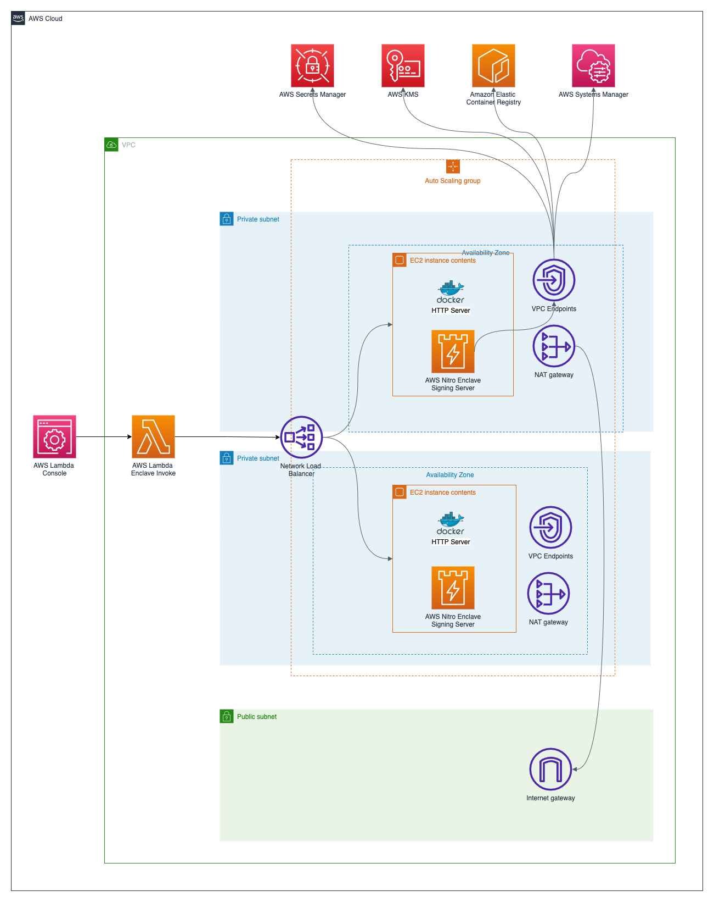
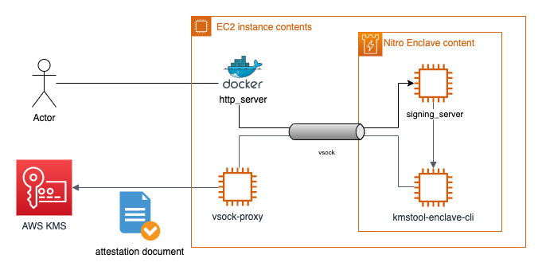

# Nitro Enclave Signer (eth1)

This directory contains the Nitro Enclave-based Ethereum signing service used
by the main project. It is derived from
[`aws-samples/aws-nitro-enclave-blockchain-wallet`](https://github.com/aws-samples/aws-nitro-enclave-blockchain-wallet)
(Amazon.com, Inc., MIT-0 — see [LICENSE](LICENSE)), trimmed to the `eth1`
application type. The other advanced networking patterns from the upstream
sample (`wireguard`, `socat`, `rds_integration`, `https_web_server`,
`dotnet_sqs_integration`) are not included.

For deployment, configuration, and operations, see the project-level guides:

- **[Nitro Enclave Deployment](../docs/nitro-enclave-deployment.md)** — detailed stack setup
- **[Deployment Guide](../docs/deployment-guide.md)** — full end-to-end deployment

## Background

For deeper context on the original Nitro Enclave blockchain wallet architecture
(attestation, KMS integration, enclave-to-host vsock signing), see the AWS blog
series the upstream sample was released alongside:

1. [AWS Nitro Enclaves for secure blockchain key management: Part 1](https://aws.amazon.com/blogs/database/part-1-aws-nitro-enclaves-for-secure-blockchain-key-management/)
2. [AWS Nitro Enclaves for secure blockchain key management: Part 2](https://aws.amazon.com/blogs/database/part-2-aws-nitro-enclaves-for-secure-blockchain-key-management/)
3. [AWS Nitro Enclaves for secure blockchain key management: Part 3](https://aws.amazon.com/blogs/database/part-3-aws-nitro-enclaves-for-secure-blockchain-key-management/)

## Architecture

### High level

### Application

## License

The upstream code is licensed under the MIT-0 License by Amazon.com, Inc.
See [LICENSE](LICENSE). The rest of this repository is licensed under the same
MIT No Attribution License (MIT-0); see the [root LICENSE file](../LICENSE).
